  

  

<!--

  

 -->

### 🇺🇸 English

**Cybersecurity Analyst** focused on **Blue Team & SOC Operations**, combining a strong background in **Linux Administration & Networking** with practical experience in **24x7 Security Monitoring, Incident Response, and Detection Engineering**. 

Currently pursuing a Postgraduate degree in *Offensive Security and Cyber Intelligence* and holding practical offensive certifications (**CRTA** & **SYCP**), I have hands-on lab experience with core pentesting and traffic analysis tools (**Nmap, Burp Suite, Caido, Gobuster/FFUF, Metasploit, BloodHound, and Wireshark**). I leverage this offensive foundation strictly as a defensive asset—understanding attack mechanics to quickly identify threat patterns, build sharper detection rules, and harden infrastructures.

#### 🛡️ Core Competencies & Arsenal
- **SOC & Incident Response:** Alert Triage, Log Analysis, Root Cause Investigation, Playbooks/SOPs, and MITRE ATT&CK mapping.
- **SIEM & EDR:** Wazuh (custom XML/Regex rules & decoders), Securonix, Rapid7, CrowdStrike Falcon, and Trend Micro.
- **Threat Intelligence & Hunting:** Cyber Threat Hunting, OSINT (Shodan, Censys, Google Dorking), and IoC enrichment.
- **Offensive Knowledge (Defensive Application):** Hands-on lab experience with reconnaissance, web exploitation, and AD enumeration tools (Nmap, Burp Suite, Caido, Gobuster/FFUF, Metasploit, BloodHound, Hydra, and Wireshark) for attack pattern and log signature recognition.
- **Infrastructure & Hardening:** Linux Sysadmin (Ubuntu/Debian/RHEL), TCP/IP Networking, Firewalls (Fortigate, pfSense), Active Directory, Zabbix & Grafana.
- **Scripting & Automation:** Bash / Shell Scripting and Python for log parsing and operational tasks.
- **Certifications:** Microsoft SC-900 | Microsoft AZ-900 | CRTA (CyberWarfare Labs) | SYCP (Solyd) *(Currently studying for CompTIA Security+ & SC-200)*.

#### 📌 Focus Areas in this GitHub
- Custom SIEM detection rules and decoders (Wazuh / Sigma).
- Incident Response write-ups and Blue Team lab walkthroughs (Let's Defend / CyberDefenders).
- Bash & Python scripts for log analysis, threat hunting, and Linux hardening.

---

### 🇧🇷 Português

**Analista de Cibersegurança** com foco em **Blue Team e Operações de SOC**, unindo uma sólida base prévia em **Administração Linux e Redes** com vivência prática em **Monitoramento 24x7, Resposta a Incidentes e Engenharia de Detecção**.

Pós-graduando em *Segurança Ofensiva e Inteligência Cibernética* e certificado em treinamentos práticos ofensivos (**CRTA** e **SYCP**), possuo vivência em laboratórios com as principais ferramentas utilizadas em pentest e análise de tráfego (**Nmap, Burp Suite, Caido, Gobuster/FFUF, Metasploit, BloodHound e Wireshark**). Aplico esse aprendizado estritamente na defesa—compreendendo a mecânica dos ataques para identificar padrões de ameaças com precisão, aprimorar regras de detecção e fortalecer infraestruturas.

#### 🛡️ Competências Principais & Ferramentas
- **SOC & Resposta a Incidentes:** Triagem de alertas, análise de logs, investigação de causa raiz, criação de Playbooks/SOPs e mapeamento MITRE ATT&CK.
- **SIEM & EDR:** Wazuh (regras customizadas XML/Regex e decodificadores), Securonix, Rapid7, CrowdStrike Falcon e Trend Micro.
- **Threat Intelligence & Hunting:** Cyber Threat Hunting, OSINT (Shodan, Censys, Google Dorking) e enriquecimento de IoCs.
- **Base Ofensiva (Aplicada à Defesa):** Prática em laboratórios com ferramentas de reconhecimento, exploração web e enumeração AD (Nmap, Burp Suite, Caido, Gobuster/FFUF, Metasploit, BloodHound, Hydra e Wireshark) para identificação de assinaturas e padrões de ataque.
- **Infraestrutura & Hardening:** Administração de servidores Linux, Redes TCP/IP, Firewalls (Fortigate, pfSense), Active Directory, Zabbix e Grafana.
- **Scripting & Automação:** Bash / Shell Scripting e Python para parsing de logs e automação operacional.
- **Certificações:** Microsoft SC-900 | Microsoft AZ-900 | CRTA (CyberWarfare Labs) | SYCP (Solyd) *(Em preparação para CompTIA Security+ e SC-200)*.

#### 📌 O que você encontrará por aqui
- Regras de detecção e decodificadores customizados para SIEM (Wazuh / Sigma).
- *Write-ups* de Resposta a Incidentes e resoluções de laboratórios Blue Team (Let's Defend / CyberDefenders).
- Scripts em Bash e Python voltados para análise de logs, Threat Hunting e Hardening Linux.

---

### 📫 Connect with me / Conecte-se comigo
- **LinkedIn:** [linkedin.com/in/erick-ans](https://www.linkedin.com/in/erick-ans/)
- **Blue Team Labs (LetsDefend):** [app.letsdefend.io/user/Kr4k0w](https://app.letsdefend.io/user/Kr4k0w)
